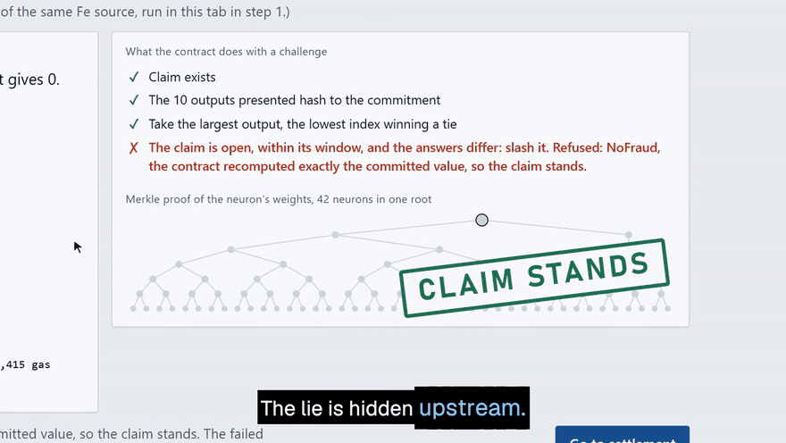

# Tensile

[](https://github.com/AbrahamPaulJ/tensile/actions/workflows/ci.yml)

**Pitch:** One integer neural-network kernel, written once in Fe with shapes and fixed-point scales in
its types, runs natively and in WebAssembly to classify, and on the EVM to settle a dispute: a false
answer posted on-chain is proven false by re-running a single neuron, at 9.4% of the gas of running the
whole network. An honest answer, claimed and finalised with no dispute, costs 15.6%.

[](https://abrahampaulj.github.io/tensile/demo/)

**[Try it live](https://abrahampaulj.github.io/tensile/demo/)** in the browser: no wallet, no install, no
server. **[Watch it](https://abrahampaulj.github.io/tensile/#video)**, two and a half minutes (the clip above
is 14 seconds of it). **[Catch a lie on Sepolia](https://abrahampaulj.github.io/tensile/sepolia/)**: a
dozen claims were posted on a public chain, some false, and the page re-runs the network in your browser,
names the wrong neuron and asks the chain whether the challenge would win; with a wallet you can send it
and keep half the bond. Addresses and every transaction: [`docs/sepolia.md`](docs/sepolia.md).
**[Watch the fee tier live](https://abrahampaulj.github.io/tensile/fee-live/)**: the fee-tier example runs on
Sepolia on real mainnet data. A keeper relays the mainnet USDC/WETH pool's tick at every 50th block,
`FeeOracle` (Fe) builds the model's input from those ticks, and about every hour the keeper posts the
network's tier with a bond; one deliberately false claim from a second account was slashed. The page
re-reads every relayed tick from mainnet and re-runs every claim in your browser. The relay is a trust
assumption a mainnet deployment would not have (the oracle would read the pool itself), and it is checked
tick by tick. Addresses and every transaction: [`docs/sepolia-fee.md`](docs/sepolia-fee.md).
**[The project page](https://abrahampaulj.github.io/tensile/)** has all of these. The demo is also [`demo/dist/tensile-demo.html`](demo/dist/tensile-demo.html), one self-contained
file that opens from disk, and the video is [`demo/video/tensile-demo.mp4`](demo/video/tensile-demo.mp4).

**Not only digits.** The same generator built two models someone could use, each with a consumer contract
in Fe: [a fee tier for an AMM pool](examples/amm-fee/README.md), predicted from a year of the mainnet
USDC/WETH pool's own ticks (right on 4,399 of 7,711 held-out windows, against 3,779 for "same as the last
four hours"), where the contract rebuilds the model's input from ticks it read itself; and
[a scam-risk score for Ethereum accounts](examples/address-risk/README.md) (89.35% against a baseline of
83.37%). **[Try the fee tier live](https://abrahampaulj.github.io/tensile/fee/)**: the `examples/amm-fee`
contracts run in your browser on a year of real pool ticks, `FeeOracle` builds the model's input from the
ticks it observes, a false claim is slashed by re-running one neuron, and a claim that is correct about
another window is refused, which is why the consumer checks the input hash. Four models from 1,042 to 109,386 parameters show
[where a dispute pays and where it does not](#use-it-with-your-own-network).

**Not only neural networks.** [Tree ensembles](#tree-ensembles-the-same-dispute-for-the-models-people-use-on-tabular-data),
the models people actually use for tabular risk scores, get the same one-transaction dispute: a false
answer is slashed by re-walking one tree on-chain. On the scam-risk data a 300-tree forest beats the dense
network (F1 0.7065 against 0.6422), costs 1,301,202 gas to run whole on-chain and 251,287 to claim and
finalise (19.3%).

**And not only inference.** The kernel is a fixed-point library other Fe projects can import: scales in
the type, packed vectors, overflow proofs the compiler checks. [`docs/LIBRARY.md`](docs/LIBRARY.md) shows
it running a price average, a scorecard and a lending rate curve
([use the kernel as a library](#use-the-kernel-as-a-library)).

**For a judge with five minutes**, from the repository root:

| Command | Needs | What it shows | Time |
|---|---|---|---|
| open [the live demo](https://abrahampaulj.github.io/tensile/demo/) | a browser | draw a digit, post a lie, watch one neuron disprove it | 2 min |
| `fe test` | Fe 26.5.1 | 72 tests: kernel, model against the reference, dispute rule, contracts | 25 s |
| `node wasm/diff.mjs` | Node 20+ | the committed WebAssembly module against the NumPy reference: 10,000 images, 0 mismatches | 4 s |
| `bash tools/check_compile_fail.sh -v` | Fe 26.5.1 | 13 wrong models that must not compile (a bias at the wrong scale, mismatched layers...), each with the compiler's message, and one correct control that must | 17 s |

## The problem

Running a neural network inside a smart contract is possible and costly: this project's small MNIST
network costs 1,896,043 gas per answer. Paying that for every answer rules out almost any use.

The known way out is optimistic: post the answer with a bond, and let anyone prove it wrong within a
time window. Then only a dispute costs anything, and it need only re-run one step. That has a catch.
The dispute is worth nothing unless the step re-run on-chain computes *exactly* what the off-chain run
computed, down to the rounding of a negative number. Usually these are two code bases in two languages,
kept in step by hope.

Who would use it: a contract that needs a model's answer (a risk score before a loan, a classifier
gating a payout) and cannot afford to compute it. An operator runs the model off-chain and posts the
answer with a bond. Anyone who doubts it runs the same Fe kernel on their own machine, and one
transaction settles who was right. The consuming contract reads `result(id)` once the claim is final.
Tensile is also for Fe builders who want typed numeric code that compiles to every backend.

## Approach

- **One kernel, three targets.** `ingots/tensile` is pure Fe with no effects. The native classifier,
  the on-chain arbiter and a WebAssembly module call the same `neuron` function. The NumPy reference
  and the native, EVM and WebAssembly builds agree bit for bit: 0 mismatches on all 10,000 MNIST test
  classes and 1,000 full traces, on every backend, at every optimisation level tested. In the demo,
  the WebAssembly build is the watcher's own off-chain run.
- **The types carry the model.** `Row<IN, FW>`, `Activations<N, F>` and `Q<F>` hold shape and scale as
  const generics. Wiring layers of the wrong shape, mixing scales, or giving a bias the wrong scale does
  not compile. A `static_assert` proves that no accumulator can overflow, for every possible input.
- **A dispute re-runs one neuron.** A claim commits to the input, every hidden activation, every output
  and the answer. A challenger names one wrong value and presents the neuron's weights with a Merkle
  proof against the model's root. The contract holds no weights and never runs a layer.
- **The rule is a pure function.** `dispute::step(claim, now, action)` is the whole lifecycle, with no
  storage or clock, unit-tested on both backends, and `dispute::shares` splits the bond. Its deadline
  rules, and that every bond is shared out to the last wei, are `static_assert`s.
- **Why not `core::fixed`.** Fe's standard fixed point is unsigned decimal on 256-bit words
  (`UFixed<D>`, a power-of-ten scale). A network needs signed values with a binary point: 8-bit
  weights and activations packed 32 to a word, 32-bit accumulators, and requantisation as an
  arithmetic shift. `Q<F>` is that, an `i32` with `F` fractional bits, so it is its own type.
- **Why not `core::bytes::PackedBytes`.** `Packed<N>` has the same layout, 32 signed bytes to a word.
  `PackedBytes` keeps its field private and is built only by `from_array`, which the compile-time
  evaluator cannot run over this model's 25,088 weights (`docs/fe-notes.md`, section 4), so the weights
  could not be a constant. `Packed<N>` is built from words, so the generator can write them as literals.
- **Built on `std` wherever `std` has it.** Proofs are checked by `std::evm::merkle`, the bond is a
  `Wei`, the window a `Duration` and deadlines `Timestamp`s from `std::evm::units`, credits live in a
  `StorageMap`. The only arithmetic Tensile adds is the part the standard library does not have.

Everything was built during the contest window. Integer accuracy is 97.44% on the MNIST test set; the
floating-point model it came from reaches 97.50%.

## Fe highlight

Many Fe libraries put a scale in a type. Tensile computes with scales in types: the neuron's signature
states the rule of fixed-point multiplication, so a bias must have the scale of a weight times an
activation, `F + FW` fractional bits, and a compile-time function in the `where` clause proves that
the accumulator cannot overflow for any input of that length:

```rust
// ingots/tensile/src/dense.fe
pub fn neuron<const IN: usize, const FW: usize, const F: usize>(
    row: Row<IN, FW>,
    x: Activations<IN, F>,
    bias: Q<{ F + FW }>,
) -> Q<{ F + FW }>
where dot_fits_i32(IN)
```

Get it wrong and the compiler says so (`tests/compile_fail/bias_wrong_scale.fe`, one of 13 such cases):

```
error[8-0000]: type mismatch
  │     dense(weights, x, bias)
  │                       ^^^^ expected `Bias<2, 14>`, but `Bias<2, 15>` is given
```

All of that disappears at compile time. Measured against the same contract written over plain words,
the types cost **2.1%** of a layer 1 neuron's execution gas, and the pure state machine under 1% of a
call (`docs/numbers.md`, section 2).

Fe's effects also make the security argument readable. Of the arbiter's handlers, exactly one declares
that it can send ETH:

```rust
// ingots/onchain/src/arbiter.fe
Finalize { id } uses (ctx, count, mut claims, mut credits, mut burned, mut log) {
Withdraw -> Wei uses (ctx, mut call, mut credits, mut log) {
```

And the kernel defines an effect of its own. A forward pass shows every hidden layer to a `Probe`, whose
method is generic over the layer's width and scale, and the caller decides what is watching: the native
CLI's trace mode supplies a printer, everything else supplies `Blind`, which looks at nothing. One
forward pass serves both, with no flag and no second copy:

```rust
// ingots/tensile/src/probe.fe
pub trait Probe {
    fn hidden<const N: usize, const F: usize>(mut self, layer: usize, _ activations: Activations<N, F>)
}

// ingots/model/src/lib.fe
pub fn forward(x: Input) -> Logits uses (probe: mut Probe) {

// ingots/cli/src/lib.fe
let logits = with (Probe = printer) {
```

## Architecture

| Path | Language | What it is |
|---|---|---|
| `ingots/tensile` | Fe, pure | `Packed`, `Row`, `Weights`, `Activations`, `Q`, `Bias`; `neuron`, `dense`, requantise, argmax; the compile-time overflow bound |
| `ingots/model` | Fe, generated | The weights as packed literals and the typed layer chain, from `tools/gen_fe.py` |
| `ingots/dispute` | Fe, pure | The claim state machine |
| `ingots/cli` | Fe, native | The classifier and auditor: reads samples or claims on stdin, names the first failing check |
| `ingots/onchain` | Fe, contracts | `Arbiter`, `Network`, `NeuronCheck`, `RowsLow`, `RowsHigh`, the leaf commitment |
| `wasm/` | Fe, WebAssembly | An ingot of its own: `src/lib.fe`, the module's exports, on top of `tensile` and `model`; the built module in `wasm/out/` |
| `ref/` | Python, NumPy | Training, quantisation, and the integer reference: the oracle every other part must match |
| `evm/` | Solidity | Foundry fuzz and invariant tests of the Fe bytecode; Solidity twins as gas baselines |
| `demo/` | JavaScript | The page: an EVM in the browser running the `fe build` output |
| `tools/` | Python, shell | Generator, differential tests, check scripts, mutation test, numbers |

```
                     ingots/tensile  (pure kernel, types)
                       │         │
               ingots/model   ingots/dispute (pure lifecycle)
                 │       │       │
   ingots/cli (native)  ingots/onchain (EVM)       wasm/ (WebAssembly)
        │                        │                     │
   names the challenge  ──►  Arbiter re-runs     the demo's watcher
                             that one neuron
```

The arithmetic is specified in `docs/spec.md`, the protocol in `docs/spec-dispute.md`, what the build
learned about Fe in `docs/fe-notes.md`.

### What a dispute does

1. A claimant posts input, 32 hidden values, 10 outputs and the answer, with a bond (246,113 gas).
2. A watcher re-runs the network off-chain with the native build. The first value that differs names
   the challenge.
3. The arbiter checks the vectors against the claim's hashes, checks the neuron's weights against the
   model root, re-runs that one neuron, and on a mismatch credits the challenger half the bond and
   burns the rest, so a false claim costs at least half its bond even if its own claimant slashes it
   (178,662 gas at layer 1, 73,142 at layer 2, 63,540 for the answer).
4. A claim nobody disproves becomes final after the window (49,034 gas), and only then does
   `result(id)` answer. Bonds are pulled with `withdraw()`, the only handler that sends ETH.

## Use it with your own network

Tensile is a tool, not one demo model. `tools/gen_fe.py` writes the typed kernel constants for any chain of
dense layers and `tools/gen_arbiter.py` writes its arbiter: the claim record, one challenge per layer, and
the contract tests. For the shipped model the generator's output equals the hand-written contract byte for
byte, source and bytecode (`tools/check_arbiter_gen.sh --bytecode`), so the fuzz suite, the Solidity twin
and the mutation run are evidence about the generator too. [`docs/USAGE.md`](docs/USAGE.md) takes a model
file to a tested, deployable arbiter in five commands, and shows a consumer contract that acts on a final
result. A wrong model is refused by the Fe compiler, not by the generator: layers that do not chain, scales
that disagree, or an accumulator that could overflow are type errors and failed `static_assert`s.

Three more models went through all of it, each with its own generated arbiter, tests, a check script that
CI runs, and a results page that includes the unflattering rows:

- **A fee tier for an AMM pool** ([`examples/amm-fee`](examples/amm-fee/README.md)), 144-32-16-3, trained on
  one year of the mainnet Uniswap v3 USDC/WETH pool's own ticks to pick the tier for the next four hours.
  On the last 55 days, held out, it is right on 4,399 of 7,711 windows, against 3,779 for "same as the
  last four hours" and 2,802 for the best constant. Its consumer, `FeeOracle`, written in Fe, builds the
  model's input byte for byte from ticks it read from the pool and applies a fee only from a finalised
  claim whose committed input hash matches, so the input is as checkable as the arithmetic.
- **A scam-risk score for Ethereum accounts** ([`examples/address-risk`](examples/address-risk/README.md)),
  14-32-16-2, from 14 public transaction-history features: 89.35% on 7,054 held-out accounts against 83.37%
  for always answering "not flagged" (precision 72.79%, recall 57.46%). Its consumer, `RiskGate`, admits
  only accounts a finalised claim has cleared. A screening signal, not a verdict.
- **A larger digit model** ([`examples/mnist-784-128-64-10`](examples/mnist-784-128-64-10/RESULTS.md)),
  98.81% on the test set as integers.

For all of them the native build matches the NumPy reference with 0 mismatches. Measured the same way as
the shipped model, they show where a dispute pays and where it does not:

| | Address risk 14-32-16-2 | Fee tier 144-32-16-3 | Digits 784-32-10 (shipped) | Digits 784-128-64-10 |
|---|---|---|---|---|
| Parameters | 1,042 | 5,219 | 25,450 | 109,386 |
| Whole network on-chain, gas | 154,748 | 466,408 | 1,896,043 | 8,219,318 |
| `claim`, gas | 230,399 | 239,460 | 246,113 | 274,284 |
| Honest path (`claim` + `finalize`), gas | 281,361 | 290,511 | 295,147 | 325,255 |
| Honest path against one whole run | 181.8% | 62.3% | 15.6% | 4.0% |
| Dearest dispute (first slash), gas | 101,727 | 116,791 | 178,662 | 185,003 |
| Dearest dispute against one whole run | 65.7% | 25.0% | 9.4% | 2.3% |

The three-layer arbiters the generator writes are tested as hard as the hand-written one. They pass the
same Foundry fuzz and invariant suite, 50 tests each, with tests added for what only a multi-layer arbiter
can get wrong: the middle layer checked against another layer's hash or leaf, a lie carried forward that
must be slashed only where it starts (`tools/gen_foundry.sh`, a CI job). The oracle is the network written
again in plain Solidity, sharing no code with the Fe kernel or the generator. A mutation run of 81 faults
planted in the generated fee-tier arbiter, 31 of them faults only a multi-layer arbiter can have, ends with
78 killed by tests, 2 refused by the compiler and 1 survivor, which reads a value through another type of
the same layout and is argued equivalent
([`docs/mutation-results-generated.md`](docs/mutation-results-generated.md)).

**Small models should simply be called; the dispute pays from a few thousand parameters up.** At 1,042
parameters the whole network runs on-chain for 154,748 gas, less than a claim, so the generated `Network`
contract is the right tool and the arbiter is not. At 5,219 a claim is cheaper than a run, but only just
once the consumer's own bookkeeping is counted (`examples/amm-fee/RESULTS.md`). From there the gap opens:
across these four models the cost of running grows 53 times and the cost of an honest claim 1.16 times.

**A dispute is priced by the one neuron it re-runs, not by the network:** between the two digit models, 4.3
times the parameters cost 4.33 times as much to run and 1.04 times as much to dispute. There is no bisection game because none is needed:
a claim publishes every layer's output, so one transaction names the wrong neuron directly. What does grow
is the claim, with the sum of the layer widths (1.11x here), and a dispute is never much cheaper than
about 66,000 gas however small the neuron. The largest model's whole run is already 49% of the
per-transaction gas cap; its dispute is not.

## Tree ensembles: the same dispute for the models people use on tabular data

`ingots/trees` is a second kernel on the same types, for gradient-boosted trees and random forests:
`Tree<DEPTH, IN, LF>` and `Forest<TREES, DEPTH, IN, CLASSES, LF>`, with the no-overflow proof of the score
sum in a `where` clause. A claim commits to the input and to every tree's output. One challenge names a
tree, and the contract re-walks it (6 comparisons at depth 6) against a Merkle proof of that tree, with the
same `Tree::eval` the off-chain forest runs; the other re-adds the committed outputs and compares the
class. If any tree's output is wrong the first succeeds; if all are right the class follows from them, so
a wrong class falls to the second. `ingots/dispute`, the claim state machine, is reused unchanged. Spec:
[`docs/spec-trees.md`](docs/spec-trees.md).

On the address-risk data ([`examples/address-risk-trees`](examples/address-risk-trees/README.md)), a
forest of 300 trees of depth 6, chosen on validation and scored once on the same 7,054 held-out accounts:

| | Forest 300x6 | Dense 14-32-16-2 | Always "not flagged" |
|---|---|---|---|
| Accuracy | 91.22% | 89.35% | 83.37% |
| Precision | 79.59% | 72.79% | |
| Recall | 63.51% | 57.46% | |
| F1 | 0.7065 | 0.6422 | |
| Whole model on-chain, gas | 1,301,202 | 154,748 | |
| Honest path (`claim` + `finalize`), gas | 251,287 | 281,361 | |
| Honest path against one whole run | 19.3% | 181.8% | |
| Dearest dispute, gas | 118,880 | 101,727 | |
| Dearest dispute against one whole run | 9.1% | 65.7% | |

So on this data the better model is also the one the dispute pays for: the forest is too dear to run on
every call and cheap to claim, where the small dense network was the reverse. The unflattering rows: a
tree dispute costs more gas than a small neuron's (1,316 bytes of calldata against 452), the native
classifier is slow (20 to 25 s for 7,054 rows), and the tree arbiter has its generated Fe tests and anvil
scripts but no fuzz suite or mutation run. Choosing a whole tree per Merkle leaf over one path rests on a
calculation, not on having built both (spec section 10). One compiler limit was met and recorded
(`tests/defects/where_after_substitution.fe`).

## Use the kernel as a library

Under the inference sits a small fixed-point library for Fe: values whose binary scale is part of the
type (`Q<F>`), int8 vectors packed 32 to a word, a dot product whose overflow is ruled out by a `where`
clause, and bounds the compiler checks. `ingots/tensile` has no dependencies and works as a path or git
dependency:

```toml
tensile = { source = "https://github.com/AbrahamPaulJ/tensile", rev = "<commit>", path = "ingots/tensile" }
```

[`lib-examples/`](lib-examples/README.md) builds three contracts on it with no neural network in sight:
`TickEma` (a moving average of a pool's tick), `Scorecard` (a weighted score over 16 features) and
`RateCurve` (a kinked borrow rate). Six mistakes that compile in Solidity are compile errors there, with
the compiler's message recorded for each (`lib-examples/compile_fail/`): a missing shift after a
fixed-point multiply is "expected `Q<16>`, but `Q<28>` is given", and a rate curve that would overflow at
100% utilisation fails a `static_assert`. Measured against plain-integer twins written in Fe, the types
cost no gas where the code has the same shape (execution gas: `RateCurve` 472 against 472, `TickEma` 7,634
against 7,751), and the kernel's packed dot product runs the scorecard for 1,559 against 4,691 for a
byte-by-byte loop (`lib-examples/runs/gas.json`).
The guide, [`docs/LIBRARY.md`](docs/LIBRARY.md), starts from an empty directory, and CI runs that
walkthrough on Fe 26.5.1 and 26.7.0. API reference, generated by `fe doc`:
[abrahampaulj.github.io/tensile/api](https://abrahampaulj.github.io/tensile/api/). The example parameters
are made up; the library is not audited.

## Build and test

The exact versions used: **fe 26.5.1 (149c758)**, Foundry 1.9.0, solc 0.8.38, Python 3.11, NumPy 2.3,
Node 22. Linux or WSL2 for Fe and Foundry; run the commands from the repository root.

```sh
# Fe, pinned
curl -fsSL https://raw.githubusercontent.com/argotorg/fe/master/feup/feup.sh | bash -s -- --version v26.5.1

fe --version          # fe 26.5.1 (149c758)
sha256sum "$(command -v fe)"   # 2d48fd56e45f56a775bea73a3180ffcab73ad440887d0a985be2050fb5993916 (Linux x86-64)
fe fmt --check ingots
fe test               # 72 tests on the EVM backend, about 25 s
fe build              # the contracts, into ./out
```

The full checks need Foundry (`curl -L https://foundry.paradigm.xyz | bash && foundryup --install 1.9.0`),
`bc`, `xxd` and `python3`:

| Command | What it establishes | Time |
|---|---|---|
| `bash tools/m1_check.sh` | Both backends' unit tests, 13 compile-fail cases and their control, native against the reference on all 10,000 samples at `-O 0`, `-O 1`, `-O 2` | 68 s |
| `bash tools/m2_check.sh` | The contracts against the reference on all 10,000 classes and 1,000 traces; fuzz against a plain Solidity spec; real gas on anvil | 199 s |
| `bash tools/m3_check.sh` | The arbiter: 26 Fe contract tests, 45 Foundry fuzz and invariant tests for properties P1 to P6, auditor against Python on 5,200 mutated claims | 176 s |
| `bash tools/m4_numbers.sh` | Regenerates `docs/numbers.md`: every gas and size figure, from real transactions | 12.5 min, or about 2 min with `--no-forms` |
| `python3 tools/m3_mutants.py --fresh` | 59 deliberate faults in the contract; all are caught, 11 of them by the compiler. Results in `docs/mutation-results.md` | 977 s |
| `python3 ref/get_mnist.py && python3 ref/test_ref.py` (needs NumPy; the first downloads MNIST and checks its SHA-256) | The reference's arithmetic and exported files | 5 s |
| `bash tools/m5_clean_run.sh` | Copies only what git would publish to an empty directory, makes it `$HOME`, installs the tools, runs all the above except the mutation test and the numbers, and rebuilds the demo | 13 min |

The demo needs only Node to rebuild and test (the built page is committed):

```sh
cd demo && npm ci
npm run build         # dist/tensile-demo.html
npm test              # the page's chain against anvil's gas and the reference; every lie, on every sample
npm run test:ui       # the page itself in Chrome, offline, from file://
```

`bash tools/build_demo.sh` regenerates what the page embeds from a fresh `fe build`.

### Fe 26.7.0: the same source, and the WebAssembly build

Fe 26.6.0 and 26.7.0 came out during the contest. The kernel, the model, the dispute rule and the
contracts build and pass their tests on 26.7.0 from the same source as on 26.5.1:

```sh
curl -fsSL -o ~/fe-267/fe --create-dirs https://github.com/argotorg/fe/releases/download/v26.7.0/fe_linux_amd64 && chmod +x ~/fe-267/fe
sha256sum ~/fe-267/fe          # 4ef2b818e260f0ba0b0af4bd78468dda589dc4949503fffaef25d8188e5107d5
bash tools/check_fe267.sh      # fe check and fe test of tensile, model, dispute, onchain: 62 tests, 49 s
bash tools/build_wasm.sh       # the WebAssembly module, 70 s
```

The newer compiler makes the same contracts cheaper, measured with the same transactions
(`docs/numbers.md`, section 7): `claim` 246,113 to 220,215 gas, the whole network 1,896,043 to 1,567,610,
the arbiter 11,649 to 10,463 bytes. Against the Solidity twin that is 1.13x per claim, from 1.26x.

Fe's WebAssembly target is in the release binaries from 26.7.0 and builds whole ingots, so the module is
the small ingot `wasm/` on top of `ingots/tensile` and `ingots/model` as they stand. `tools/build_wasm.sh`
runs all 26 kernel and model unit tests on the wasm backend, builds the module twice and requires
identical bytes (33,172 bytes), then checks it against the reference: 10,000 of 10,000 classes, 10,000 of
10,000 logits and 32,000 of 32,000 hidden activations, and the same again for modules built at `-O 0`
and `-O 2`. CI does all of this with the release binary. The built module is committed, so the demo needs
neither. (Until 2026-11-23 the module was built from a master commit, `89d07b9`, because no release had
the target; the organisers allowed that.)

Times are from one laptop (i5-13420H, WSL2 Ubuntu 24.04), with the repository on the Linux file system.

### A reproducible example without a browser

```sh
fe build --backend native -O 1 --out-dir out-native --ingot cli .
head -c 784 ref/out/inputs.bin | out-native/cli          # 7
head -c 784 ref/out/inputs.bin | out-native/cli trace    # every hidden value, every output, the class
```

## Demo

Open [the live demo](https://abrahampaulj.github.io/tensile/demo/), or [`demo/dist/tensile-demo.html`](demo/dist/tensile-demo.html) from disk
(the hosted copy is that file, published with the project page in `site/` by `.github/workflows/pages.yml`). Draw a digit and the bytecode from `fe build` classifies it,
on an EVM running in the tab, and the WebAssembly build of the same source classifies it again, in well
under a millisecond, with every hidden value and output equal. Post a claim, honest or forged, and watch the watcher name the wrong value
and the contract settle it. Every refusal you see is the contract's own error, and no button is gated by
the page. The page's chain reproduces this project's anvil gas figures exactly (`demo/test/run.mjs`).

The [video](demo/video/tensile-demo.mp4) walks through the same page, recorded in real time; the zoom and the title cards are added by the
recorder. Its narration is a synthetic voice, and the script is `demo/video/script.json`.

## Limitations

- **One honest watcher.** The scheme is sound only if someone checks every claim and can get a
  transaction in before the deadline, as with every optimistic protocol. A false claim nobody challenges
  becomes final. The demo shows this.
- **Half the bond is burned on every slash.** That closes the claimant's own escape (slashing its false
  claim before anyone else to get the bond back): it now costs half the bond, not just gas. The price is
  that an honest challenger earns half the bond, not all of it, and the burned half stays in the arbiter
  for good (`burned()`). Pinned by tests and `static_assert`s (`docs/spec-dispute.md`, sections 4 and 7).
- **Challenges can be front-run,** so the reward may go to whoever copies a challenge from the mempool.
  The fraud is still caught.
- **Deployment parameters are not checked.** A bond or window of zero is accepted, so a consumer must read
  `modelRoot()`, `bond()` and `window()` before trusting an arbiter.
- **The model root is trusted as deployed.** Anyone can rebuild it from the model file and compare.
- **It proves a computation, not a good model.** The arbiter says a claim matches the committed integer
  network, nothing about whether the network is right about the digit: it is wrong on 2.56% of the test
  set, and hand-drawn digits are harder still.
- **Dense networks and tree ensembles only.** No convolution. Layer sizes are compile-time, so each model gets its own
  generated arbiter. Layer 1's weights do not fit one contract, so `Network` reads them from others. One
  overflow proof can visit about 150,000 weights, which bounds a single layer. The native auditor and the
  WebAssembly module are built for the shipped model; the other models' off-chain side is their native
  classifier and the reference.
- **The two practical models are demonstrations, not products.** The fee model is one pool, one year and
  one seed, beats a weak baseline, and nothing here measures whether such a fee earns liquidity providers
  anything; no Uniswap v4 hook is built. The risk model's features come from a published data set, and
  `RiskGate` does not check that the 14 bytes belong to the account. Each example's README lists its
  limits. The generated arbiters of amm-fee and address-risk are under the full fuzz and invariant runs,
  and amm-fee's is under a mutation run as well; the larger digit model's arbiter is fuzzed only at reduced
  counts, and the tree arbiter not at all. The digit model and the fee model are on Sepolia
  (`docs/sepolia.md`, `docs/sepolia-fee.md`); there the fee oracle reads a relay that the keeper fills with
  mainnet's ticks, a trust assumption the watcher and the status page check against mainnet. The keeper is
  a scheduled GitHub workflow with a throwaway key and a spending cap: it can run late, skip, or stop when
  its test ETH runs out; the page shows how far the relay is behind mainnet.
- **Not audited, and on a testnet only.** The contracts are on Sepolia (`docs/sepolia.md`), with test ETH,
  and nowhere else. Sepolia already runs the next fork, which charges more for new storage, so its
  receipts are higher than the figures here, which are measured under mainnet's current rules. The
  mutation test's 59 faults were chosen by hand, so "59 of 59" is not a random sample. Do not hold real
  value with this.
- **Fe costs more gas than the best hand-written Solidity here:** 1.24x per neuron transaction and 1.26x
  per claim (`docs/numbers.md`, section 3), and 2.36x the code. This is like for like: the Solidity twin
  is the best hand-written version found, and its arbiter passes the same Foundry suite. Fe is cheaper than the natural Solidity
  assembly loop (0.78x). Most of the 1.24x is a choice, not the compiler: a kernel written for the EVM
  alone, unrolled over 256-bit words, costs 1.06x (section 5), but it is eight times slower natively, and
  this entry ships one kernel for every target. Where the rest goes is measured opcode by opcode in
  [`docs/gas-gap.md`](docs/gas-gap.md): 68.7% of the neuron's gap is masks on narrow integers, most of
  them on values that provably fit, and 27.4% is decoding array arguments into memory. The page lists
  what the compiler could do about each and reproduces with `python3 tools/gas_gap.py`. Those are Fe at `-O 1` against solc via-IR. `-O 2` moves no gas figure by more than
  0.03%, and solc without via-IR cannot compile the arbiter's twin at all, "Stack too deep" (section 6).
- **Measured on Fe 26.5.1; the native CLI needs that version.** Every figure here comes from 26.5.1, and
  the Sepolia contracts are its output. The kernel, the generated model, the dispute rule and the
  contracts also pass `fe check` and `fe test` unchanged on the 26.7.0 release (`tools/check_fe267.sh`,
  a CI job), and the 26.5.1 bytecode did not change by a byte when the source was made to build on
  both. The native classifier and auditor (`ingots/cli`) do not build on 26.7.0, because the native I/O
  interface they use (`std::io::host`, `std::native::Args`) was replaced. Install 26.5.1 with the
  command above.
- **The demo's chain is EthereumJS, not a real network.** Its watcher runs the WebAssembly build of the
  kernel, not the native auditor (`ingots/cli`), which does not run in a browser.
- **The WebAssembly module is built with a different release, 26.7.0,** the first with the target. Only
  the kernel and the model are built for it; the dispute logic and the auditor are not.

Compiler defects found along the way, with minimal examples: `docs/upstream-reports.md`. Five were filed
(argotorg/fe#1950 to #1954), and the Fe team fixed all five on master (PRs #1955 to #1959). This entry still builds with
the pinned versions it names, so none of those fixes are in the figures here. Every finding was then run
again on the 26.7.0 release (`docs/upstream-recheck-26.7.0.md`: of 31, 15 are fixed and 10 still present),
and five more issues were filed with minimal examples (argotorg/fe#2071 to #2075). One of them dates a
regression: the masks that make up most of the gas gap were mostly removed by 26.6.0 and came back in
26.7.0 for byte lanes, so the same neuron costs 54,588 gas on 26.5.1, 44,470 on 26.6.0 and 46,035 on 26.7.0.

## Declaration

- **Pre-existing work:** none. The project started in the build window, on 2026-11-05, from the
  [contest starter](https://github.com/fe-lang/builders-challenge-starter)'s template and CI.
- **Third-party code and data:**
  EthereumJS (`@ethereumjs/*`, MPL-2.0 and MIT) and noble-hashes and noble-curves (MIT) are bundled into the demo page,
  listed in `demo/THIRD_PARTY.txt`, unmodified. esbuild (MIT) and Playwright (Apache-2.0) are development tools.
  OpenZeppelin's `MerkleProof` is the model for the sorted-pair tree format, via Fe's `std::evm::merkle`; none of its code is used.
  The MNIST database (LeCun, Cortes, Burges) is the data: the test images are in `ref/out/`.
  The video's narration uses the Kokoro text-to-speech model (Apache-2.0), its captions the caption tool of
  ffmpeg-skill (MIT, not bundled) and the Geist fonts (SIL OFL, in `demo/video/fonts/`); its music is generated by `demo/video/music.py`.
- **AI assistance:** extensive. Claude (Anthropic), through Claude Code, did the research, wrote most of
  the Fe, Solidity, Python and JavaScript, the tests and these documents, and ran the measurements, under
  the direction of the human author, who chose the project and its scope and made the decisions on it.
  Every figure here comes from a recorded run of a script in this repository.

## Team

[AbrahamPaulJ](https://github.com/AbrahamPaulJ).

## License

Apache-2.0, see [`LICENSE`](LICENSE). `demo/dist/tensile-demo.html` bundles the third-party code listed above
under its own licenses.
